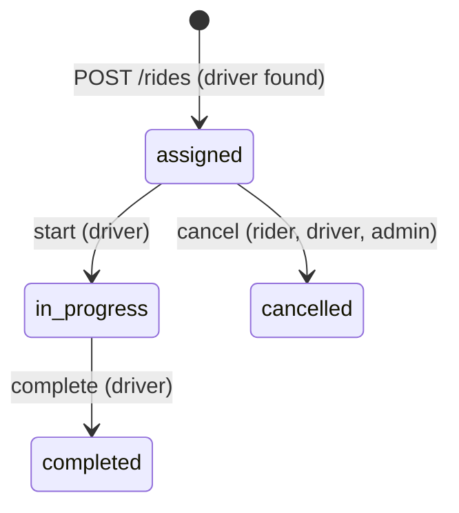

# Ride Booking & Driver Assignment API

A FastAPI + PostgreSQL backend where riders request rides, the nearest available
driver is assigned **immediately and atomically**, and drivers move rides through
a strict lifecycle while tracking their history and earnings.

**Stack:** Python 3.13 · FastAPI · SQLAlchemy 2 (async) · PostgreSQL · Alembic ·
JWT (PyJWT + bcrypt) · pytest · Docker Compose · uv · ruff

---

## Quick start

Requires Docker and [uv](https://docs.astral.sh/uv/).

```bash
cp .env.example .env      # defaults work locally
make run                  # Postgres + API (+ pgweb); migrations and admin seed run on start
```

| What | Where |
|---|---|
| Interactive API docs (Swagger) | http://localhost:8000/docs |
| Health check | http://localhost:8000/api/v1/health |
| Database browser (pgweb) | http://localhost:8081 |
| Admin login | `admin@example.com` / `change-me` (from `.env`) |

In Swagger: call `POST /auth/login`, copy `access_token`, click **Authorize** and paste it.

### Run the tests

```bash
uv sync                   # install dependencies (incl. dev)
make run_db               # Postgres only (creates the separate *_test database)
make test                 # 270 tests against real Postgres
make coverage             # with coverage report (currently ~99%, floor 90%)
make lint                 # ruff check + format check
```

Tests never touch the dev database: they refuse to run unless `TEST_DATABASE_URL`
is set and different from `DATABASE_URL`.

---

## A ride, end to end

```bash
API=http://localhost:8000/api/v1
json='content-type: application/json'
login() { curl -s -X POST $API/auth/login -H "$json" \
  -d "{\"email\":\"$1\",\"password\":\"S3cure-pass\"}" | jq -r .access_token; }

# 1. A driver signs up, registers a vehicle and goes online
curl -s -X POST $API/auth/register -H "$json" \
  -d '{"email":"dev@example.com","password":"S3cure-pass","full_name":"Dev Driver","role":"driver"}' | jq
D=$(login dev@example.com)
curl -s -X POST $API/drivers/profile -H "Authorization: Bearer $D" -H "$json" \
  -d '{"vehicle_model":"Toyota Prius","license_plate":"KA-01 AB 1234"}' | jq
curl -s -X PATCH $API/drivers/me/availability -H "Authorization: Bearer $D" -H "$json" \
  -d '{"is_available":true,"lat":12.9716,"lng":77.5946}' | jq

# 2. A rider requests a ride -> driver assigned in the same transaction
curl -s -X POST $API/auth/register -H "$json" \
  -d '{"email":"asha@example.com","password":"S3cure-pass","full_name":"Asha","role":"rider"}' | jq
R=$(login asha@example.com)
RIDE=$(curl -s -X POST $API/rides -H "Authorization: Bearer $R" -H "$json" -d '{
  "pickup":  {"address":"MG Road","lat":12.9756,"lng":77.6059},
  "dropoff": {"address":"Indiranagar","lat":12.9784,"lng":77.6408}}' | jq .id)

# 3. The driver starts and completes it, then checks earnings
curl -s -X POST $API/rides/$RIDE/start    -H "Authorization: Bearer $D" | jq .status
curl -s -X POST $API/rides/$RIDE/complete -H "Authorization: Bearer $D" | jq .final_fare
curl -s "$API/drivers/me/earnings?group_by=day" -H "Authorization: Bearer $D" | jq
```

While that ride is active, any other rider gets `409 NO_DRIVER_AVAILABLE`; once it
is completed (or cancelled) the driver is back online and can be assigned again.
The commands use [`jq`](https://jqlang.org/) to pretty-print responses.

---

## API overview

All routes are under `/api/v1`. Every error has the same shape:

```json
{ "error": { "code": "INVALID_STATE_TRANSITION",
             "message": "Cannot complete a ride that is assigned.",
             "details": { "status": "assigned", "action": "complete" } } }
```

| Method | Path | Who | Purpose |
|---|---|---|---|
| POST | `/auth/register` | public | Sign up as rider or driver (admins are seeded, never self-registered) |
| POST | `/auth/login` | public | Email + password → JWT |
| GET | `/users/me` | any | Current user |
| POST | `/drivers/profile` | driver | Register vehicle; starts offline |
| GET | `/drivers/me` | driver | Own profile |
| PATCH | `/drivers/me/availability` | driver | Go online/offline, report location |
| GET | `/drivers/me/rides` | driver | Full ride history (status + date filters, paginated) |
| GET | `/drivers/me/earnings` | driver | Totals, count, average; optional day/week/month breakdown |
| GET | `/drivers` | admin | All drivers, filter by availability |
| POST | `/rides` | rider | Request a ride → driver assigned now, or `409 NO_DRIVER_AVAILABLE` |
| GET | `/rides` | any | Rides you're part of (admins: all), status filter, paginated |
| GET | `/rides/{id}` | participant/admin | One ride (`404` for anyone else) |
| POST | `/rides/{id}/start` | assigned driver | `assigned → in_progress` |
| POST | `/rides/{id}/complete` | assigned driver | `in_progress → completed`; sets final fare, frees driver |
| POST | `/rides/{id}/cancel` | rider / driver / admin | `assigned → cancelled`; frees driver |
| GET | `/health` | public | Liveness + DB connectivity (`503` if DB is down) |

### Main error codes

| Status | Codes |
|---|---|
| 401 | `NOT_AUTHENTICATED`, `INVALID_CREDENTIALS` |
| 403 | `PERMISSION_DENIED` |
| 404 | `RIDE_NOT_FOUND`, `DRIVER_PROFILE_NOT_FOUND` |
| 409 | `NO_DRIVER_AVAILABLE`, `ACTIVE_RIDE_EXISTS`, `INVALID_STATE_TRANSITION`, `EMAIL_ALREADY_REGISTERED`, `LICENSE_PLATE_TAKEN`, `DRIVER_PROFILE_EXISTS` |
| 422 | `VALIDATION_ERROR` (with per-field `details`) |

---

## Design decisions

### Architecture

```
app/
├── api/           routers, dependencies (session, auth, role guards), error mapping
├── services/      business rules: auth, drivers, rides, state machine, pricing, earnings
├── repositories/  SQL only — no business rules
├── models/        SQLAlchemy models, enums, constraints
├── schemas/       Pydantic request/response models
├── core/          config, security, domain exceptions, geo
└── db/            engines, sessions
```

Dependencies point one way: `api → services → repositories → models`. Services
raise **domain exceptions** (`NoDriverAvailableError`, …) that know nothing about
HTTP; `app/api/errors.py` maps them to status codes in one place, by class
hierarchy, so a new conflict type is automatically a 409.

### Ride lifecycle — a table-driven state machine



There is **no pending state**: a ride only exists once a driver is assigned. All
rules live in one table in `app/services/ride_lifecycle.py` (allowed source states,
target, permitted actors, timestamp to set, whether the driver is freed). It is
pure code, unit-tested exhaustively against every status × action × actor
combination. Permission is checked before state, so a rider trying to `start`
gets 403 regardless of status; a valid actor at the wrong time gets 409.

### Driver assignment and concurrency

The core problem: two simultaneous requests must never get the same driver.

1. **Row locking with `FOR UPDATE SKIP LOCKED`.** One query picks the nearest
   available driver (haversine distance computed in SQL; drivers without a
   location last; ties go to the longest-idle driver) and locks that row.
   Concurrent requests *skip* a driver being assigned instead of waiting, so they
   move on to the next-best driver immediately.
2. **One transaction.** The driver is marked busy and the ride inserted together;
   if no driver is found, nothing is written.
3. **The database is the final guard.** Partial unique indexes allow at most one
   active ride per driver *and* per rider. If a race ever slips past the
   application checks, the violation is mapped to the correct 409 (tests force
   this path on purpose).
4. **Lifecycle actions lock the ride, then its driver**; assignment and
   availability changes only lock drivers. A single lock order means no deadlocks,
   and a "start" racing a "cancel" resolves to exactly one winner.

These are verified by concurrency tests that fire real parallel requests on
separate connections (8 riders/1 driver → exactly 1 ride; 5/5 → each driver once;
4 starts + 4 cancels → exactly 1 success). Each was checked by **removing the
lock and confirming the test fails**.

### Transactions

One transaction per request (`DbSession` in `app/api/deps.py`), committed with
FastAPI's `scope="function"` so the commit happens **before** the response is
sent — a failed commit becomes an error response, never a false success. Services
only `flush()`; they never commit.

### Database design

- `users`, `drivers` (1:1 profile), `rides`; enums stored as VARCHAR + CHECK.
- **CHECK constraints tie status to data**: e.g. a `completed` ride must have
  `started_at`, `completed_at` and `final_fare`; coordinates must be in range.
  Invalid states are unrepresentable even if a service has a bug.
- Indexes for each access pattern: partial index on available drivers, rider
  listing, and `(driver_id, status, completed_at)` for history and earnings.
- Deterministic constraint names (naming convention), which services use to map
  specific violations to specific errors.
- Migrations via Alembic; the container applies them on start.

### Money, coordinates and time

- Money is `Decimal` / `NUMERIC(10,2)` end to end and serialised as a **string**
  (`"7.05"`) so no precision is lost. Fare = `FARE_BASE + FARE_PER_KM × distance`.
- Coordinates are `NUMERIC(9,6)`, validated and rounded on input.
- Earnings are aggregated **in SQL** (`SUM`, `COUNT`, `date_trunc`). Grouping
  converts to UTC first, so results don't depend on the DB session time zone
  (tested by running the suite with the session set to Asia/Kolkata).

### Authentication

- `JWT_SECRET_KEY` must be at least 32 characters (HS256 key length); the
  dev placeholder in `.env.example` is refused when `ENVIRONMENT=production`,
  as is the placeholder admin password.
- bcrypt hashing runs in a worker thread (it is deliberately slow and would block
  the event loop). Cost is configurable (`BCRYPT_ROUNDS`; tests use 4).
- JWT access tokens; the user is **re-read from the database on every request**,
  so disabling an account or changing a role takes effect immediately and a token
  claiming a different role is ignored.
- Login takes the same time for unknown emails as for wrong passwords, and returns
  the same error, so accounts can't be enumerated.
- Users unrelated to a ride get **404, not 403**, so ride ids can't be probed.

### Testing strategy

- Tests run against **real PostgreSQL** (the locking, partial indexes and CHECK
  constraints are the point — SQLite would test something else).
- The schema is built by the real Alembic migrations, and a test asserts the
  models and migrations don't drift.
- Each test runs in a transaction that is rolled back; each API request inside a
  test gets its own savepoint, mirroring production's request-per-transaction.
- Layers: pure unit tests (state machine, pricing, security, error mapping),
  API integration tests, concurrency tests on committed data, and tests that
  force each unique-constraint fallback.

---

## Assumptions

- **Roles:** rider, driver, admin. Admins are created by the seed script from
  `ADMIN_EMAIL` / `ADMIN_PASSWORD` (idempotent; never promotes an existing account).
- **Assignment is immediate.** No driver free → `409`, nothing saved, rider retries.
  No queue, no manual assignment.
- **One active ride** per rider and per driver.
- **Cancellation** is allowed only before pickup (`assigned`).
- **Fare:** straight-line (haversine) distance, no routing service. The final fare
  equals the estimate (no live tracking); drivers keep 100% (no commission).
- **No maximum pickup radius:** the nearest available driver is assigned however
  far away.
- **Dates** in `from`/`to` filters are whole UTC days, inclusive. History filters
  on request time; earnings on completion time.
- A driver goes back online automatically after completing or cancelling.

## Future improvements

- Request queue / retry instead of an immediate 409 when no driver is free
- Maximum pickup radius and PostGIS (`geography` + GiST index) for driver search at scale
- Real routing and dynamic pricing; platform commission
- Refresh tokens, token revocation, rate limiting on login
- Real-time updates (WebSockets) for ride status and driver location
- Ratings, payments, structured logging and metrics
- CI pipeline running lint, migrations and tests on every push

---

## Development reference

```bash
make run_dev                        # API on the host with hot reload (DB via make run_db)
make migrate                        # alembic upgrade head
make generate_migrations msg="..."  # autogenerate a migration
make seed                           # create the admin user
make format                         # ruff fix + format
make down                           # stop containers
```

Configuration lives in `.env` (see `.env.example`); every setting is declared in
`app/core/config.py`.
